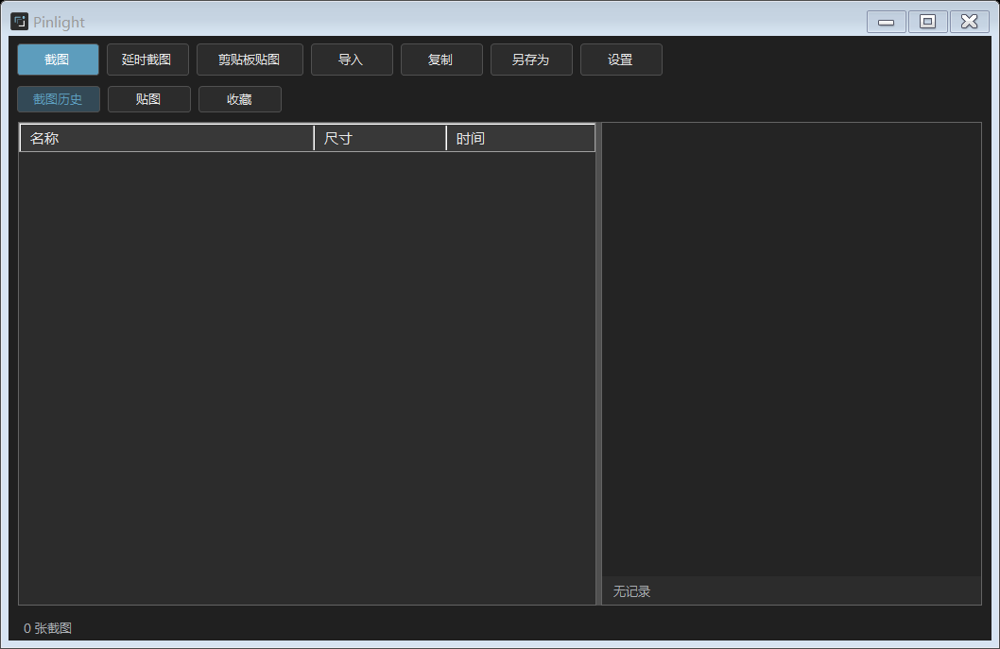
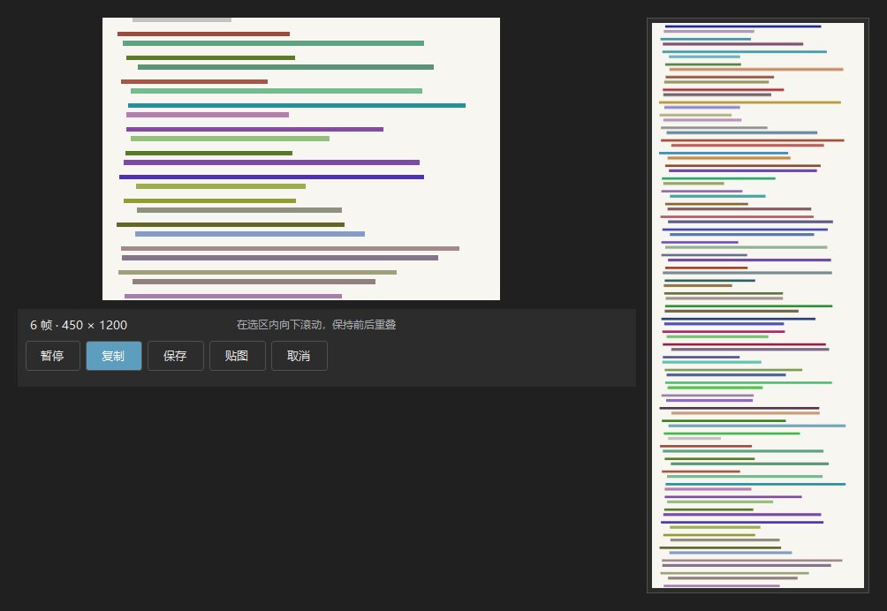

# Pinlight

Pinlight is a lightweight, offline screenshot and pin-to-screen utility for Windows. It provides region capture, annotations, floating image pins, persistent local history, custom global shortcuts, and scrolling capture with a live side preview.

[Download the latest release](https://github.com/goodwei567/Pinlight/releases/latest)


## Screenshots

| Workspace | Scrolling capture |
| --- | --- |
|  |  |

## Features

- Pixel-accurate region capture with automatic desktop-composition refresh.
- Rectangle, ellipse, arrow, pen, highlight, text, step marker, mosaic, and blur tools.
- Undo and redo for annotations, including editable and movable text.
- Scrolling capture for long pages and documents, with a live side preview.
- Pin screenshots above other windows, with zoom, opacity, rotation, and click-through.
- Four configurable global shortcuts with conflict detection and safe rollback.
- Local screenshot history, favorites, export, copy, and restoration of pins.
- Offline operation with no account, telemetry, or network access.

## Requirements

- Windows 10 or Windows 11, x64.
- .NET Framework 4.8.

The current application interface is in Simplified Chinese.

## Install

1. Open the [latest release](https://github.com/goodwei567/Pinlight/releases/latest).
2. Download `Pinlight-v0.3.2-win-x64.zip`.
3. Extract the archive and run `Pinlight.exe`.

Pinlight does not require administrator privileges. The executable is currently unsigned, so Windows SmartScreen may show an unknown publisher warning.

## Usage

Pinlight stays in the system tray when its main window is closed. Right-click the tray icon to exit.

| Shortcut | Action |
| --- | --- |
| `F1` | Start a screenshot |
| `F3` | Pin the clipboard image or create a text card |
| `Shift+F3` | Hide or show all pins |
| `F4` | Toggle mouse click-through for a pin |

All four shortcuts can be changed in Settings.

### Capture and annotate

1. Press `F1` and drag a region.
2. Select an annotation tool and draw inside the selection.
3. Press `Enter` to copy, `Ctrl+S` to save, or use the pin button.
4. Press `Esc` to cancel. Use `Ctrl+Z` and `Ctrl+Y` to undo or redo.

### Scrolling capture

1. Press `F1` and select only the scrollable content. Fixed headers and toolbars should be outside the selection.
2. Click **Scrolling Capture** in the annotation toolbar.
3. Scroll down continuously inside the selected region. A live preview appears beside the region.
4. When finished, copy, save, or pin the long capture.

Pinlight samples the selected region about every 30 ms. Consecutive frames need a small visible overlap. Extremely fast jumps, animations, moving windows, and changes to the window size or zoom can prevent stitching; if the app reports that it is waiting for overlap, scroll back slightly and continue.

Scrolling capture supports downward growth only. The maximum result is 30,000 pixels high and 50 million pixels total. Export is lossless PNG at physical screen pixels.

## Data and privacy

Pinlight stores history, pins, and settings under:

```text
%LOCALAPPDATA%\PinlightDesktop
```

Capture data remains on the local computer. The application does not connect to the network.

## Build from source

Prerequisites:

- Windows 10 or Windows 11, x64.
- .NET Framework 4.8 and its C# compiler.

Run PowerShell from the repository root:

```powershell
powershell -NoProfile -ExecutionPolicy Bypass -File .\build.ps1
```

The executable is written to:

```text
build\Pinlight.exe
```

The build has no NuGet packages or external runtime dependencies.

## Run the tests

The test suite uses the real desktop, clipboard, global hotkeys, and temporary windows. Close any running Pinlight instance before testing.

```powershell
.\build\Pinlight.exe --self-test .\test-output
```

The report is written to `test-output\self-test-report.txt`. Version 0.3.2 passes 38 automated checks.

## Known limitations

- Screen capture currently uses GDI + `CopyFromScreen`.
- Mixed-DPI multi-monitor layouts, HDR color, and protected content have not been fully validated.
- Scrolling capture cannot reconstruct content with no overlapping pixels between samples.
- The application is unsigned and has no automatic updater.

## License

This project is licensed under the [MIT License](LICENSE).

## Repository layout

```text
src/             C# WinForms source
assets/          Application icon
docs/            Repository screenshots
release-assets/  Local release files for GitHub Releases
build.ps1        Reproducible Windows build script
```
"# Pinlight" 
